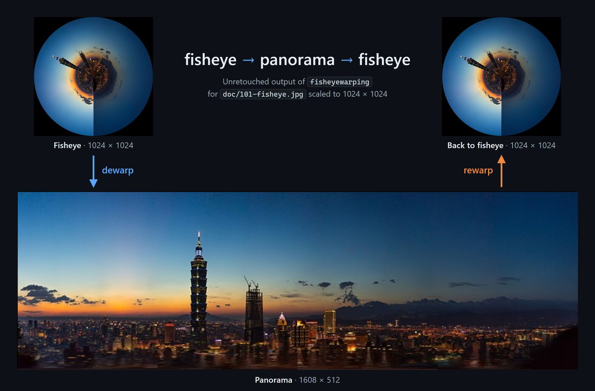
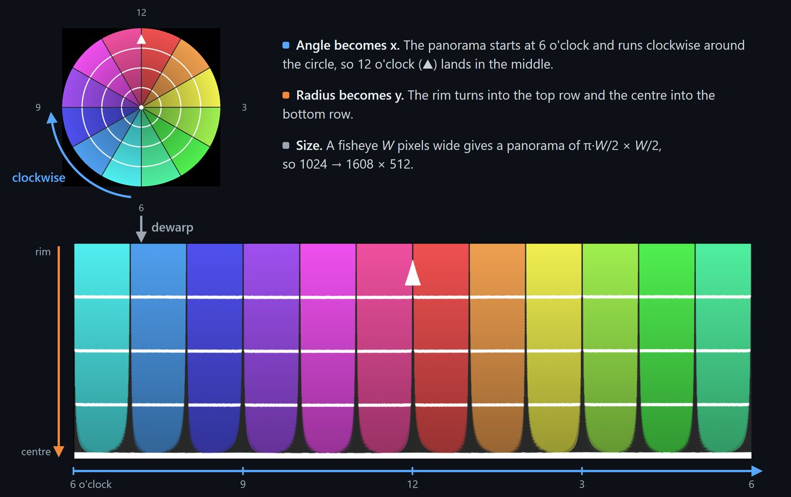

<div align="center">

# Fisheye Warping

**Unroll a top-down fisheye image into a panorama, and wrap any panorama back into a fisheye image.**

[](https://pypi.org/project/FisheyeWarping/)
[](https://pypi.org/project/FisheyeWarping/)
[](https://github.com/NatLee/fisheye-warping/actions/workflows/test.yml)
[](https://github.com/NatLee/fisheye-warping/blob/main/LICENSE)
[](https://pypi.org/project/FisheyeWarping/)



</div>

FisheyeWarping is a Python package and command-line tool built on OpenCV. It **dewarps** a top-down
fisheye image (a ceiling camera, a 360° camera pointing up or down, a "tiny planet" photo) into a flat
panorama, and **rewarps** a panorama back into a fisheye circle. The slow part, working out where every
pixel goes, is done once per image size and saved as a **mesh** file. After that, each image of that
size takes a fraction of a second.

## How it works



Read the fisheye image like a clock face. Dewarping uses polar coordinates: the angle around the centre
becomes the horizontal axis, and the distance from the centre becomes the vertical axis. The panorama
starts at 6 o'clock and runs clockwise; the rim of the circle becomes the top row and the centre the
bottom row. Rewarping does the reverse.

Working out these pixel-to-pixel maps is the slow part, so the tool does it once and saves them as
meshes. `cv2.remap` then moves the pixels in milliseconds. Rewarping needs both meshes: the rewarp mesh
says where each fisheye pixel comes from, and the dewarp mesh holds the panorama size it expects. Any
panorama you rewarp is resized to that size first.

### The maths

Take a square fisheye image *F* of *N* × *N* pixels. Its centre is (*c*, *c*) and its radius *R*,
both *N*/2. Pixel (*x*, *y*) is column *x* and row *y*, so *x* grows to the right and *y* downwards.
The panorama *P* is *W* × *H* pixels:

```math
W = \lfloor \pi R \rfloor, \qquad H = R
```

*W* is the length of the circle at half the radius, so the panorama keeps the scale there: it
squeezes pixels together towards the rim and stretches them towards the centre. A 1024 × 1024 image
gives a 1608 × 512 panorama.

**Dewarp.** Column *u* of the panorama is an angle *φ*, measured clockwise from 6 o'clock, and row
*v* is a distance *r* from the centre, counted from the rim:

```math
\varphi = \frac{2\pi u}{W}, \qquad r = R - v, \qquad
P(u, v) = F\big(\lfloor c - r\,\sin\varphi \rfloor,\ \lfloor c + r\,\cos\varphi \rfloor\big)
```

**Rewarp** runs the same map backwards. Each fisheye pixel inside the circle works out its distance
*r* from the centre and its clockwise angle *ψ* from 6 o'clock, and reads the panorama there. Pixels
outside the circle stay black.

```math
r = \sqrt{(x - c)^2 + (y - c)^2}, \qquad
\psi = \mathrm{atan2}(c - x,\ y - c) \bmod 2\pi, \qquad
F(x, y) = P\Big(\frac{W\psi}{2\pi},\ R - r\Big) \quad \text{for } r \le R
```

Dewarping copies whole pixels (the ⌊ ⌋ rounds down). Rewarping lands between pixels, so it blends
the four nearest ones (bilinear interpolation). The code reaches these maps in a roundabout way: it
turns images by 180° and mirrors the panorama for the left half of the circle. The result is within
1 pixel of the formulas, and
[a test](https://github.com/NatLee/fisheye-warping/blob/main/tests/test_readme_formulas.py) checks that.

## Install

```bash
pip install FisheyeWarping
```

Python 3.6 or newer. This also installs OpenCV (`opencv-python`), NumPy and tqdm.

> **Getting `AttributeError: ... has no attribute 'itemset'`?** Version 1.0.1, the newest release on
> PyPI when this README was written, crashes with NumPy 2, which every new install gets. The fix is on
> `main` but not released yet. Until it is, install from GitHub:
>
> ```bash
> pip install "git+https://github.com/NatLee/fisheye-warping"
> ```

**Slim Docker images and servers without a desktop.** `opencv-python` needs two system libraries that
slim images leave out; without them `import cv2` fails with `libxcb.so.1` or `libgthread-2.0.so.0`
missing. On Debian-based images such as `python:3.12-slim`:

```bash
apt-get update && apt-get install -y --no-install-recommends libgl1 libglib2.0-0
```

## Quick start

The examples use a square, top-down fisheye image `fisheye.jpg` and a panorama `panorama.jpg` in the
current folder. To try it with the photo above, scale
[`doc/101-fisheye.jpg`](https://github.com/NatLee/fisheye-warping/blob/main/doc/101-fisheye.jpg) down to
1024 × 1024 first (the Mesh files section explains why).

### Command line

```bash
# First image of this size: build both meshes (slow, once) and write the panorama to dewarp-output.png
fisheyewarping --fisheye_img_path fisheye.jpg \
  --save_dewarp_mesh_path dewarp-mesh.pkl --save_rewarp_mesh_path rewarp-mesh.pkl

# Any other fisheye image of the same size: reuse the dewarp mesh (fast)
fisheyewarping --fisheye_img_path fisheye.jpg --load_dewarp_mesh_path dewarp-mesh.pkl

# Any panorama: wrap it into a fisheye image, written to rewarp-output.png
fisheyewarping --panorama_img_path panorama.jpg \
  --load_dewarp_mesh_path dewarp-mesh.pkl --load_rewarp_mesh_path rewarp-mesh.pkl
```

### Python

```python
import cv2
from fisheyewarping import FisheyeWarping

if __name__ == '__main__':  # needed with use_multiprocessing=True, see the note below
    warper = FisheyeWarping(cv2.imread('fisheye.jpg'), use_multiprocessing=True)

    warper.build_dewarp_mesh(save_path='dewarp-mesh.pkl')  # slow, once per image size
    panorama = warper.run_dewarp(save_path='panorama-out.png')

    warper.build_rewarp_mesh(save_path='rewarp-mesh.pkl')  # needs the dewarp mesh
    fisheye = warper.run_rewarp_with_mesh(cv2.imread('panorama.jpg'), save_path='fisheye-out.png')
```

Next time, load the meshes instead of building them:

```python
import cv2
from fisheyewarping import FisheyeWarping

# Rewarp a panorama: no fisheye image needed, only the two meshes
warper = FisheyeWarping(None)
warper.load_dewarp_mesh('dewarp-mesh.pkl')
warper.load_rewarp_mesh('rewarp-mesh.pkl')
fisheye = warper.run_rewarp_with_mesh(cv2.imread('panorama.jpg'), save_path='fisheye-out.png')

# Dewarp another fisheye image of the same size
warper = FisheyeWarping(cv2.imread('fisheye.jpg'))
warper.load_dewarp_mesh('dewarp-mesh.pkl')
panorama = warper.run_dewarp(save_path='panorama-out.png')
```

> **Multiprocessing in scripts.** With `use_multiprocessing=True`, building a mesh starts one worker
> process per CPU core. Put that code under `if __name__ == '__main__':`, or the script stops with a
> `RuntimeError` on Windows, on macOS and on Python 3.14 or newer. The command line tool takes care of
> this itself. The defaults differ: the command uses multiprocessing unless you pass
> `--use_multiprocessing False`, the Python class only when you ask for it.

## Command line reference

Run it as `fisheyewarping` or as `python -m fisheyewarping`; the second form helps on Windows when
pip's Scripts folder is not on `PATH`. `fisheyewarping --help` lists everything below with examples.

What the command does depends on which images you give it:

- **A fisheye image** (`--fisheye_img_path`): fisheye → panorama. It needs `--save_dewarp_mesh_path` to
  build the mesh or `--load_dewarp_mesh_path` to reuse one. Add `--save_rewarp_mesh_path` to also build
  the rewarp mesh for later.
- **A panorama** (`--panorama_img_path`): panorama → fisheye. It needs both saved meshes,
  `--load_dewarp_mesh_path` and `--load_rewarp_mesh_path`.
- **Both**: fisheye → panorama, then the given panorama → fisheye with the meshes of that fisheye image.
  It needs the dewarp mesh as above, plus `--save_rewarp_mesh_path` or `--load_rewarp_mesh_path`;
  without either, it only dewarps.

| Option | What it is | Default |
|---|---|---|
| `--fisheye_img_path PATH` | Fisheye image to dewarp (`.jpg`, `.jpeg` or `.png`, any case) | |
| `--panorama_img_path PATH` | Panorama to rewarp (`.jpg`, `.jpeg` or `.png`, any case) | |
| `--save_dewarp_mesh_path PATH` | Build the dewarp mesh and save it to this file | |
| `--save_rewarp_mesh_path PATH` | Build the rewarp mesh and save it to this file | |
| `--load_dewarp_mesh_path PATH` | Load a saved dewarp mesh instead of building one | |
| `--load_rewarp_mesh_path PATH` | Load a saved rewarp mesh instead of building one | |
| `--panorama_output PATH` | Where to write the panorama | `./dewarp-output.png` |
| `--fisheye_output PATH` | Where to write the fisheye image made from the panorama | `./rewarp-output.png` |
| `--use_multiprocessing True\|False` | Build meshes with one worker process per CPU core | `True` |

The output format follows the file extension (anything OpenCV can write, such as `.png` or `.jpg`).
When an input file or a mesh option is missing, the command says what to add and stops with exit
code 0, as it always has. When a file is there but cannot be used, such as a broken image or swapped
mesh files, it stops with exit code 1.

## Python API reference

```python
from fisheyewarping import FisheyeWarping, MeshNotReadyError
```

**`FisheyeWarping(img, use_multiprocessing=False)`**: `img` is the fisheye image as `cv2.imread`
returns it, or `None` when you only rewarp with loaded meshes. `use_multiprocessing=True` builds meshes
on all CPU cores.

| Method | What it does | Returns |
|---|---|---|
| `build_dewarp_mesh(save_path=None)` | Builds the fisheye → panorama mesh for `img`, and saves it when `save_path` is given | `(panorama_size, map_x, map_y)`, where `panorama_size` is `(width, height)` |
| `load_dewarp_mesh(mesh_path)` | Loads a saved dewarp mesh, including files saved by 1.0.x | the same as above |
| `run_dewarp(save_path=None)` | Dewarps `img` | the panorama |
| `build_rewarp_mesh(save_path=None)` | Builds the panorama → fisheye mesh for images the size of `img`. Needs the dewarp mesh. | `(map_x, map_y, mask)` |
| `load_rewarp_mesh(mesh_path)` | Loads a saved rewarp mesh | the same as above |
| `run_rewarp_with_mesh(panorama_img, save_path=None)` | Rewarps any panorama; resizes it to the panorama size first | the fisheye image |
| `run_rewarp(save_path=None)` | Round trip: dewarps `img`, then rewarps the result | the fisheye image |
| `dewarp(img, flip=False)`, `rewarp(panorama_img, flip=False)` | The plain steps; the `run_*` methods also turn the result by 180° | the image |

Images are NumPy arrays in OpenCV's BGR order. `save_path` and `mesh_path` take a `str` or a
`pathlib.Path`, and images are saved with `cv2.imwrite`.

When something is missing, you get an error that says what to do:

- `MeshNotReadyError`: the method needs a mesh you have not built or loaded yet. It is also an
  `AssertionError`, which is what 1.0.x raised, so existing `except AssertionError` code still works.
- `TypeError`: an image is `None`, which usually means `cv2.imread` could not read the file.
- `ValueError`: a mesh file holds something else, for example when the dewarp and rewarp files are swapped.
- A `UserWarning` when OpenCV could not write an output image, for example because the folder does not exist.

## Mesh files

A mesh depends only on the image size, not on what is in the image. Build it once per camera or
resolution and reuse it for every frame. The dewarp mesh holds `(panorama_size, map_x, map_y)` and the
rewarp mesh `(map_x, map_y, mask)`. Both are saved with Python's `pickle`; dewarp meshes saved by 1.0.x
still load.

Building a mesh takes time and memory in proportion to the number of pixels. Measured with Python 3.12
on a 32-core machine:

| Fisheye image | Panorama | Dewarp mesh | Rewarp mesh | Time to build both | Peak memory |
|---|---|---|---|---|---|
| 512 × 512 | 804 × 256 | 1.6 MB | 2.4 MB | 1 s | 0.2 GB |
| 1024 × 1024 | 1608 × 512 | 6.6 MB | 9.4 MB | 4 s (10 s without multiprocessing) | 0.5 GB |
| 2048 × 2048 | 3216 × 1024 | 26 MB | 38 MB | 15 s | 1.9 GB |

Once the meshes exist, loading one and dewarping an image takes well under a second. For very large
images, scale them down with `cv2.resize` before building meshes: by the numbers above, a 4096 × 4096
image would need around 8 GB.

> **Only load mesh files you trust.** Loading a pickle can run code hidden in the file. Meshes you built
> yourself are fine; treat a mesh file from someone else like a program you are about to run.

## Limitations

- **Square images only.** Other sizes are processed without errors, but the circle in a rewarped image
  comes out off-centre. Crop the image to a square around the fisheye circle first.
- **The centre pixel of a rewarped image is black**, because the angle at the exact centre is undefined.

## Development

```bash
git clone https://github.com/NatLee/fisheye-warping.git
cd fisheye-warping
pip install -e ".[test]"
pytest
```

`tox` runs the same checks as CI: the package manifest, the package metadata and the tests. Some tests
recompute the 1.0 formulas point by point, so any change to the output geometry shows up as a failing
test. CI runs on Ubuntu with Python 3.8 to 3.14, on Windows and macOS with Python 3.12, and on Python 3.6
and 3.7 in Docker containers.

The images in this README are real output of the tool: `doc/round-trip.jpg` comes from
`doc/101-fisheye.jpg`, and `doc/how-it-works.jpg` from a generated colour wheel.

## Contributors

<!-- ALL-CONTRIBUTORS-LIST:START - Do not remove or modify this section -->
<!-- prettier-ignore-start -->
<!-- markdownlint-disable -->
<table>
  <tbody>
    <tr>
      <td align="center"><a href="https://github.com/NatLee"><br /><sub><b>Nat Lee</b></sub></a></td>
    </tr>
  </tbody>
</table>

<!-- markdownlint-restore -->
<!-- prettier-ignore-end -->

<!-- ALL-CONTRIBUTORS-LIST:END -->

## License

[MIT](https://github.com/NatLee/fisheye-warping/blob/main/LICENSE)
